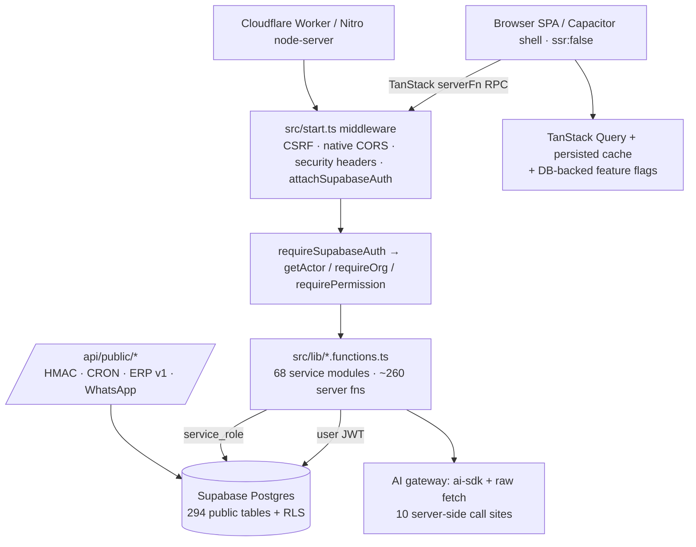

# Phase 0 — Context Reconnaissance & Architecture Audit

| Field | Value |
|---|---|
| Repository | `muslly-pharmcy/ympharma-b21a19fb` |
| Commit audited | `2d63d4e0` — `fix/security-seo-android-regression` (13 commits ahead of `main`) |
| `main` | `7ecf324d` — the PR-19 work is **not** merged here |
| Audit date | 2026-10-24 |
| Environment | Windows, Node 24.19.0, Bun 1.4.3 via `npx`, no local Supabase CLI, no live DB link |
| Scope | Phase 0 recon + 3-sprint roadmap; no source changes in this document's commit |

This is the record behind the approved roadmap. It supersedes stale claims in older
documents (`docs/architecture_report.md`, `FINAL-CERTIFICATION.md`,
`PRODUCTION-READINESS-DASHBOARD.md`) wherever they conflict with the evidence below.

---

## 1. Corrections to the development brief

| Brief assumption | Verified reality |
|---|---|
| React 18 + Vite 5 + Tailwind 3 + React Router 6 | React 19.2, Vite 8.1.6, Tailwind 4.2.1, TanStack Start 1.168.60 / TanStack Router 1.170.41; no `react-router` dependency (`package.json`) |
| Cloudflare Pages (detect, do not assume) | Cloudflare **Workers** — `wrangler.jsonc:4` (`main: @tanstack/react-start/server-entry`), `@cloudflare/vite-plugin`, `npm run validate:cloudflare` |
| PR #19 closed, fixes merged | `main` is the merge base; the fix branch is 13 commits ahead and 0 behind. Nothing from PR-19 is on `main` |
| `src/features/<domain>/` layout | No `src/features/`. Layers are `src/domain/<d>/` (schemas/commands), `src/lib/<d>*.functions.ts` (~260 `createServerFn`), `src/hooks/`, `src/routes/`, `tests/` |
| `npm run test:static` | Did not exist; static guards are ordinary `tests/*.test.ts` files inside `vitest run`. Added as a script in S0-2 |
| `scripts/check-no-secrets.mjs` | Did not exist; recreated in S0-2 with a regression test |
| Tenant column `pharmacy_id` | Tenant is `organizations.id`; membership/roles live in `organization_members` (`org_role` enum) and `branches`. `pharmacy_id` appears only on 3 partner-directory tables |
| npm is canonical | Bun is canonical (`bun.lock`; `package-lock.json` is gitignored). `npm ci` fails with ERESOLVE |

---

## 2. Architecture (verified)



Key facts:

- SSR is off (`vite.config.ts:42`); the app is a SPA shell with TanStack Start server functions.
- Auth middleware is registered globally for token attachment, but **authorization is per-handler** (`getActor` / `requireSupabaseAuth` / `requirePermission`).
- `getActor()` resolves membership with the **service-role** client (`src/lib/session.server.ts:99-105`), so RLS does not backstop a missing permission check.
- AI is server-only; there is no LLM key in the browser bundle. Clinical output carries `confidence` (`verified|partial|unverified`).

---

## 3. Build health (executed 2026-10-24)

| Check | Command | Result |
|---|---|---|
| Install | `npx bun@1.4.3 install --frozen-lockfile` | ✅ 344 packages, 781 s |
| Typecheck | `bunx tsc --noEmit` | ✅ exit 0 |
| Lint (CI) | `bunx eslint . --max-warnings=-1` | ✅ 0 errors, 28 warnings |
| Lint (strict) | `--max-warnings=0` | ❌ 28 pre-existing warnings |
| Unit tests | `bunx vitest run` | ✅ 53 files passed, 1 skipped; **500 passed / 8 skipped = 508**, 9.0 s |
| Tooling tests | `bun run test:tooling` | ✅ 10/10 |
| Node build | `bun run build` | ✅ 73.4 s; client 325 JS chunks 3.58 MB + 0.16 MB CSS; server 482 files 10.83 MB; PWA precache 330 entries / 4.31 MB |
| Worker validate | `bun run validate:cloudflare` | ✅ 50.7 s; 523 modules, 10,763.79 KiB raw / 2,375.04 KiB gzip (dry-run, no deploy) |

Notes:

- The Cloudflare bundle is **2.32 MiB compressed**, under the 3 MiB free-plan ceiling but without much headroom; `xlsx` (821 KiB) and three.js (2.1 MiB server chunk) dominate.
- `npm ci` cannot be used; any verification must use Bun to match CI (`bun install --frozen-lockfile`).
- `--max-warnings=0` is not currently satisfiable without a separate warning-cleanup change.

---

## 4. Data layer and RLS

- **259 migrations** (2026-06-16 → 2026-10-18) create **294 public tables** (+5 private-schema tables). RLS is enabled on **294/294**; 634 `CREATE POLICY` statements (≈530 effective).
- Tenant predicates: org 189, self 38, branch 7, pharmacy 2; **no tenant column on the legacy core** (`orders`, `prescriptions`, `products`, `invoices`, `insurance_claims`).
- **11 tables have RLS enabled with zero policies** (deny-all): all `erp_*` tables plus `insv2_claim_create_receipts`, `_import_*_stage`.
- `audit_logs.organization_id` is `TEXT` and readable by any global admin; newer `audit_events` is org-derived.
- 9 anonymous `INSERT` policies (intake tables) without DB-side rate limiting; 30 anon-executable definer RPCs governed by a one-time allowlist.
- `branches.organization_id` is nullable; 6 tables are branch-keyed only; `Actor.branchId` is `branch_scope[0]` (no global branch guard).
- Supabase CLI is absent and there is no `.supabase` link → **`supabase db diff` is not runnable locally**; remote/local migration divergence is documented and must not be applied blindly.
- A second, unwired schema chain exists under `drizzle/`; `supabase_schema.sql` is a stale 21-table snapshot.

---

## 5. Domain inventory (UI / API / Tests / Docs %)

| Domain | UI | API | Tests | RLS | AI | Top gap |
|---|---|---|---|---|---|---|
| POS / dispensing | 65 | 65 | 25 | ✅ | ⚠️ | no cashier/payment/receipt; POS↔checkout unlinked |
| Prescriptions + Rx OCR | 80 | 75 | 35 | ✅ | ✅ | OCR public and unlinked to structured Rx |
| Patients / family health | 80 | 75 | 55 | ✅ | ✅ | no dedupe/merge; consent lifecycle |
| Clinical tools | 85 | 70 | 40 | n/a | ⚠️ | interaction rules not versioned/signed off |
| Inventory / warehouses | 70 | 70 | 45 | ✅ | ✅ | balance written without movement/lock; no cycle count |
| Catalog / storefront | 80 | 75 | 50 | ✅ | ✅ | barcode not globally unique; no therapeutic alternatives |
| Orders / cart / checkout / delivery | 60 | 60 | 20 | ⚠️ | ❌ | **no `deliveries` table**; no cancel/tracking |
| Insurance | 75 | 80 | 70 | ⚠️ | ❌ | org scoping unproven on `main`; strongest domain |
| Doctors / directory | 65 | 60 | 5 | ✅ | ❌ | `hc_appointments` unused; zero tests |
| Laboratory / emergency / national | 10 | 0 | 0 | ✅ | ❌ | hardcoded mock arrays |
| CRM / marketing / segments | 70 | 65 | 40 | ✅ | ✅ | no delivery proof |
| Loyalty / promotions | 75 | 80 | 55 | ✅ | ❌ | expiry jobs unverified |
| Purchasing / suppliers | 60 | 60 | 5 | ✅ | ⚠️ | no AP invoices/payments/returns |
| Finance / billing | 25 | 20 | 0 | ✅ | ❌ | single ledger read; schema drift |
| Reports / analytics | 55 | 60 | 35 | ✅ | ⚠️ | UI is `setTimeout`/`alert` mock |
| Security / admin / control tower | 70 | 65 | 60 | ✅ | ⚠️ | branch isolation; service-role reliance |
| AI runtime / MCP | 55 | 70 | 50 | ✅ | ✅ | `src/super-agent/**` orphaned; `/ai-chat` demo |
| ERP / Oracle | n/a | 80 | 55 | ✅ | ❌ | hard-off; live DB unverified; legacy apply frozen |
| WhatsApp / push | 40 | 55 | 30 | ✅ | ⚠️ | webhook verifies signature only |

---

## 6. Biggest structural risk

**Authorization is opt-in and the data client bypasses RLS.** Server functions are public
by default (`src/start.ts:26` only attaches the client token), six files define server
functions with neither `requireSupabaseAuth` nor `getActor`, and `getActor()` itself uses
the service-role client — so a missing `requireOrg`/`requirePermission` is not caught by
RLS. Tenant scoping is manual `.eq('organization_id', …)` across ~260 handlers, 17 route
files still query Supabase directly, and the legacy commerce/clinical tables have no tenant
column at all. New domains must follow the strict auth + evidence pattern, and a generic
authorization guard test is required before multi-pharmacy work can be trusted.

---

## 7. Approved roadmap

| Sprint | Theme | Domains | Gate |
|---|---|---|---|
| S0 | Prerequisites (3–5 days) | land verified fixes (PR to `main`), add `test:static` + secret scan, B-01/B-05 minimal hardening | `APPROVE-PUSH` |
| 1 | Clinical Safety | `clinical-screening`, `prescription-intake`, `patient-reconciliation` | `APPROVE-DOMAIN:<name>`, `APPROVE-MIGRATION` |
| 2 | Operational Efficiency | `inventory-expiry`, `delivery-tracking`, `purchasing-receive` | same |
| 3 | Multi-Pharmacy Ready | `tenant-isolation`, `pharmacy-membership`, `role-dashboards` | same + S1/S2 stable |

Sprint 3 is blocked until Sprints 1 and 2 are merged and their gates are green.

---

## 8. Implementation constraints carried into every domain

- New domain code follows `src/domain/<d>/` + `src/lib/<d>*.server.ts` + `src/lib/<d>.functions.ts` + `src/hooks/` + route/component + `tests/`.
- Every server function is auth- and permission-guarded; cross-org IDs are rejected before any write.
- Service-layer functions return `{ data, error }`; only the `createServerFn` boundary throws.
- One additive, idempotent migration per domain; RLS enabled with org-scoped policies and explicit `REVOKE`; no renames/drops.
- AI calls are server-side only, with a deterministic fallback and `confidence` + `evidence` on every output.
- Feature flags come from `app_settings` via `public_feature_flags`; server paths enforce the flag (no client-only hiding).
- No new dependencies (`GATE-E`), no CI/lockfile/`.env*` edits, no push to `main`.

---

## 9. Verification commands

```bash
npx bun@1.4.3 install --frozen-lockfile
npx bun@1.4.3 x tsc --noEmit
npx bun@1.4.3 x eslint . --max-warnings=-1
npx bun@1.4.3 x vitest run
npx bun@1.4.3 run test:static
npx bun@1.4.3 run build
npx bun@1.4.3 run validate:cloudflare
node scripts/check-no-secrets.mjs dist/
git diff --stat <base>..HEAD
```

`check-no-secrets.mjs` separates errors (secret values, `.env` files, service-role JWTs)
from warnings (service-role identifiers in browser-shipped code). `--strict` promotes
warnings to errors for CI hardening once the two known client-boundary chunks are cleaned.
